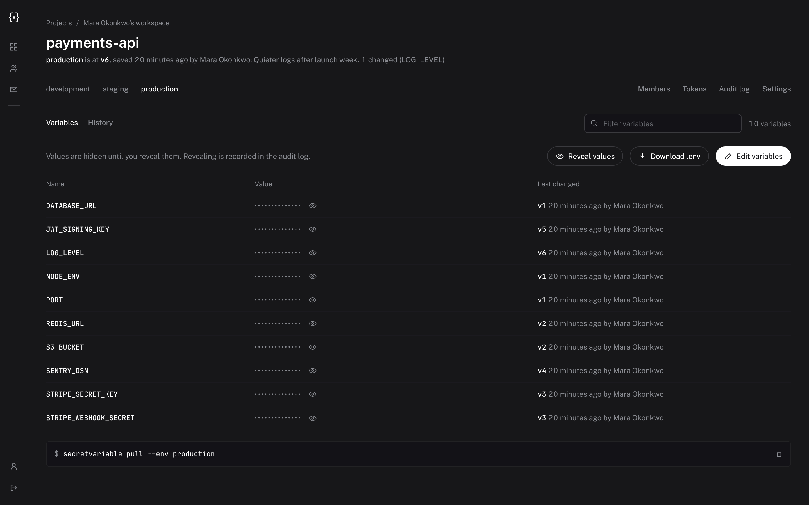
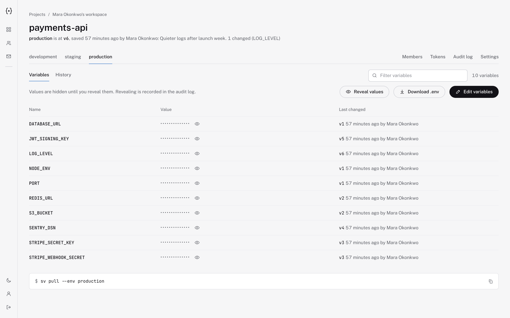
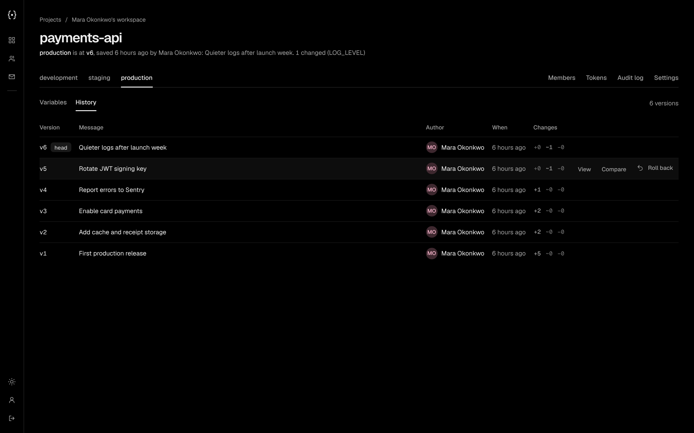
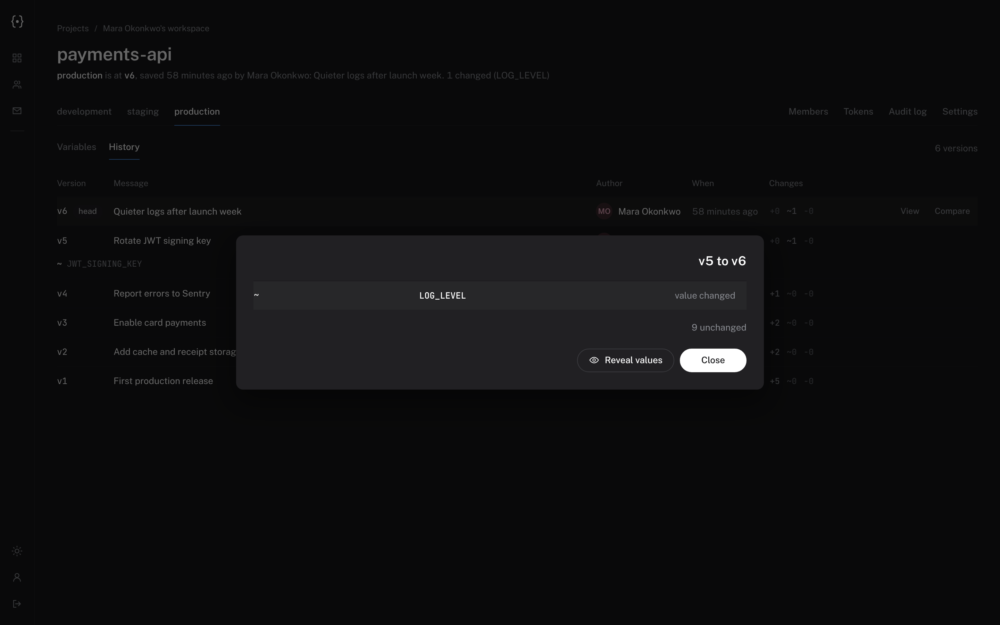
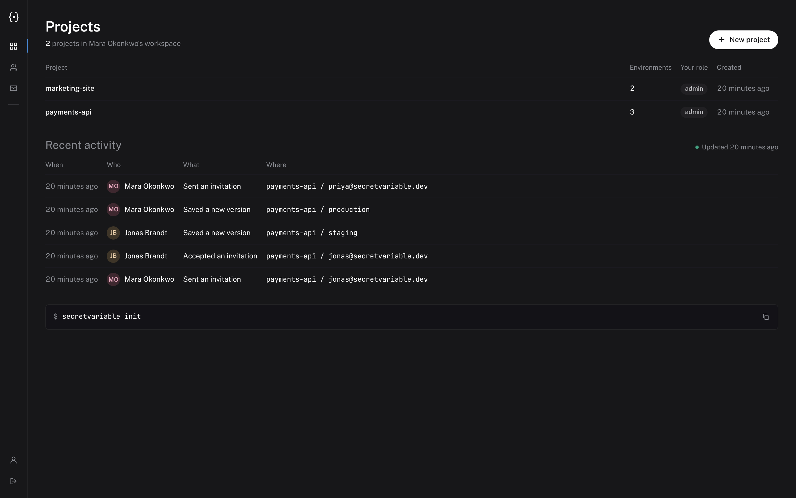
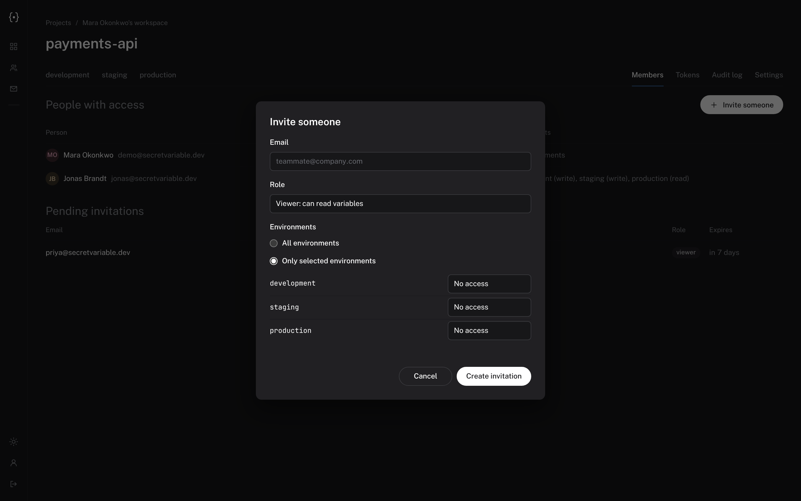
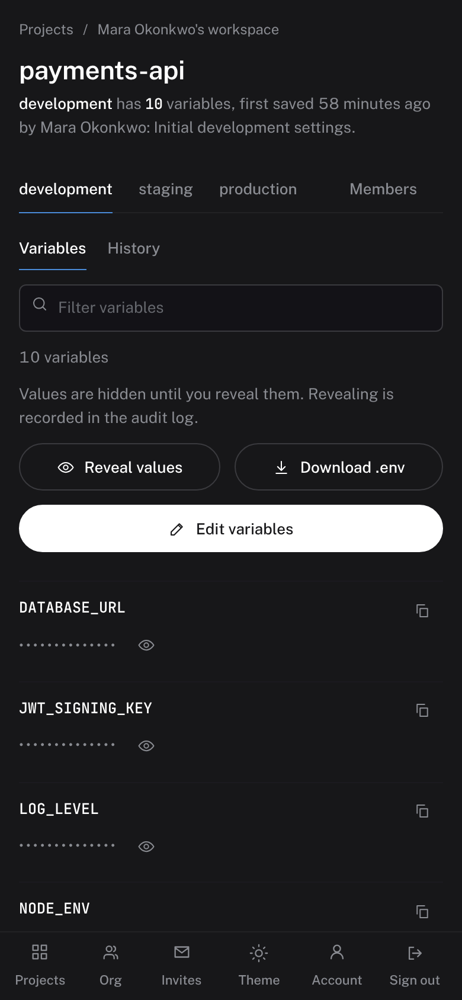
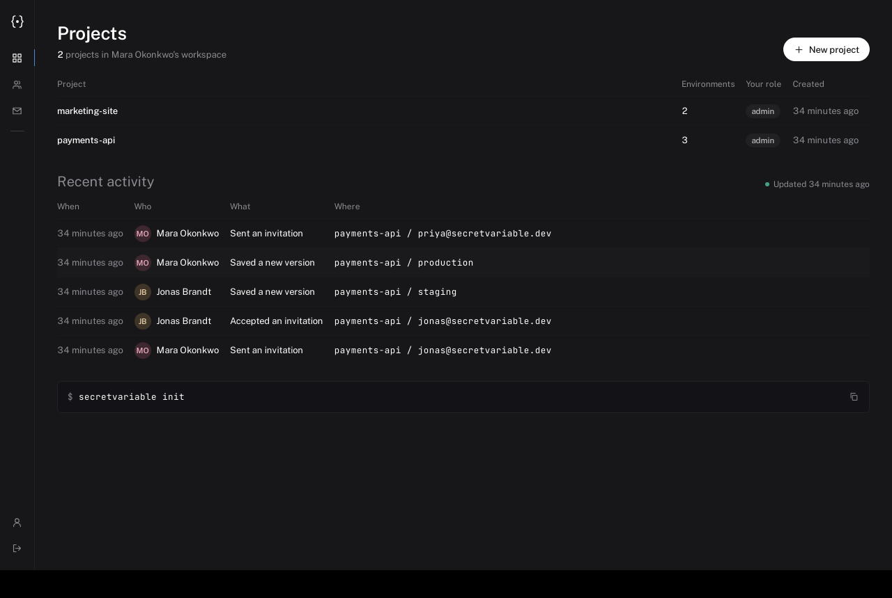

<div align="center">

# SecretVariable

**Open-source, self-hostable home for your `.env` files.**
Versioned environments, encrypted at rest, shared with exactly the people who need them.

[Quick start](#quick-start) · [Features](#features) · [CLI](#command-line) · [Self-hosting](guide/self-hosting.md) · [Security](guide/security.md) · [Contributing](CONTRIBUTING.md)

</div>



Teams keep `.env` files in chat threads, password managers and the heads of whoever set the project up. SecretVariable gives them one place: sign in, pick a project and environment, and `secvar pull` writes the `.env` your code needs. Every change is a numbered version you can compare and roll back.

## Features

- **Projects and environments.** An organisation owns projects; each project has named environments (development, staging, production, anything you add). Each environment has its own linear version history.
- **Versions, diffs, rollback.** Saving creates `v1, v2, v3 ...`. Compare any two versions (key names by default, values only on request) and roll back by saving an old version as a new one. Nothing is rewritten.
- **Encrypted at rest.** AES-256-GCM envelope encryption: a master key you control wraps a data key per project, and every value is sealed with its own nonce and bound to its key and version.
- **Access control.** Admin, editor and viewer roles, plus per-environment access: give a contractor read access to `staging` only. Hidden environments simply do not exist for them.
- **Invitations.** Single-use, email-bound, expiring links. No mail server required.
- **Web app, CLI and desktop shell.** View and edit variables in the browser (masked until you reveal them; light and dark themes), `pull`/`push`/`run` from the terminal, or use the Tauri desktop wrapper.
- **CI-friendly tokens.** Project- and environment-scoped, read-only or read/write service tokens that expire and can be revoked.
- **Audit log.** Who read, changed or shared what, and when. Secret values are never written to it.
- **Self-hostable in one image.** One container (API + web app) and PostgreSQL. MIT licensed.

<details>
<summary>More screenshots</summary>

| | |
|---|---|
|  |  |
|  |  |
|  | |

Phone layout and the native desktop app (Tauri):





</details>

## Quick start

You need Docker with Compose.

```bash
git clone https://github.com/OxygenOP/SecretVariable.git
cd SecretVariable
export SV_MASTER_KEY=$(openssl rand -hex 32)   # back this up: without it the data cannot be decrypted
echo "$SV_MASTER_KEY" > master.key && chmod 600 master.key   # keep it OUT of the repository
docker compose up -d
```

Open <http://localhost:8080>, create your account (you become the owner of a personal workspace), then create a project.

> Put the app behind HTTPS (Caddy, nginx, Traefik) before exposing it. See the [self-hosting guide](guide/self-hosting.md) for a proxy example, backups and upgrades.

## Command line

The command is `secvar` (the long name `secretvariable` works too).

```bash
npm install -g @secretvariable/cli     # once published; until then see guide/cli.md to build it
secvar login --server https://secrets.example.com
cd my-project
secvar init                    # link this folder to a project
secvar pull                    # writes .env from the current environment
secvar push -m "rotate Stripe key"
secvar run -- npm start        # inject variables, nothing written to disk
secvar log                     # version history
secvar diff 3 4                # what changed
secvar rollback 3
```

In CI, set `SECRETVARIABLE_URL` and `SECRETVARIABLE_TOKEN` (a read-only service token for one environment) instead of logging in. Full reference: [guide/cli.md](guide/cli.md).

## How it is built

```
apps/server   Fastify + PostgreSQL API (auth, orgs, projects, environments, versions, audit)
apps/web      React + Vite web app, served by the server
apps/cli      the `secretvariable` command
apps/desktop  Tauri shell around your server's web app
packages/crypto  envelope encryption primitives (AES-256-GCM)
packages/shared  .env parser/serializer/diff and shared types
```

TypeScript throughout, pnpm workspaces. See [guide/development.md](guide/development.md) to run it locally and [guide/architecture.md](guide/architecture.md) for the design.

## Security in one paragraph

The server encrypts values with keys derived from a master key you provide, so **whoever controls the server and its master key can read the secrets**. That is the trade-off that makes online viewing, sharing and rollback possible. It is not a zero-knowledge system. Passwords use Argon2id, tokens are stored only as hashes, every read is audited, and there are no secret values in logs. Read [guide/security.md](guide/security.md) for the threat model, what is and is not protected, and how to report a vulnerability ([SECURITY.md](SECURITY.md)).

## Status

Early software (`0.x`). The API, CLI and web app are covered by automated tests (server and CLI integration tests against PostgreSQL, a browser end-to-end test). Not yet implemented: two-factor authentication, master-key rotation tooling, email delivery, SSO, GitHub/Vercel secret sync. See the [roadmap](guide/roadmap.md).

## Contributing

Issues and pull requests are welcome: see [CONTRIBUTING.md](CONTRIBUTING.md).

## License

[MIT](LICENSE) © OxygenOP
